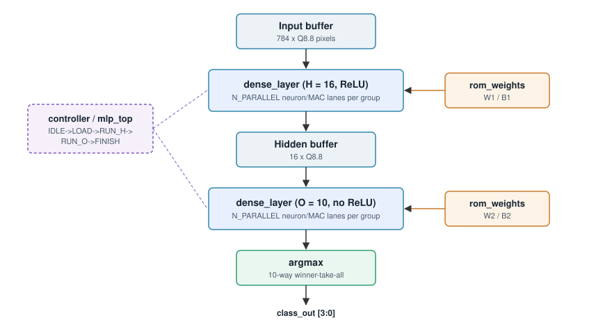
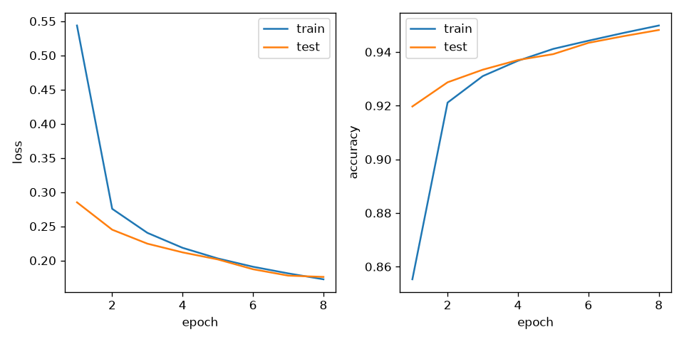
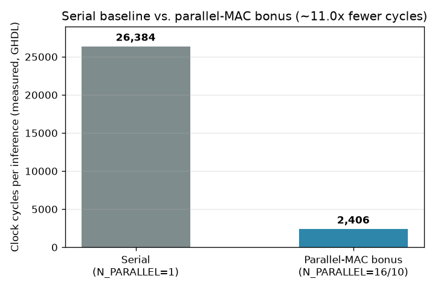
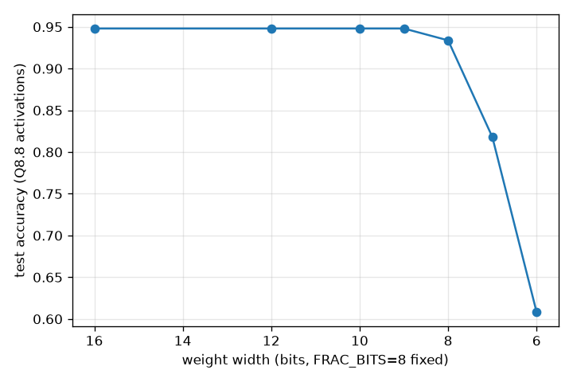

# MLP FPGA Accelerator

End-to-end hardware/software co-design of a fixed-point MLP for MNIST digit
classification: train in Python, quantize to Q8.8, export weights, run
bit-accurate inference in synthesizable VHDL, verify against the Python
golden output, and synthesize for a real FPGA device.

## Architecture



```
Input 784 → Hidden 16 (ReLU) → Output 10
```
## Results at a glance

| | Value |
|---|---|
| Float32 test accuracy | 93.80% |
| Q8.8 test accuracy | 93.80% (0 pt drop) |
| End-to-end HW vs. Python match | **10 / 10** golden MNIST images |
| Serial baseline latency | 26,384 cycles/image |
| Parallel-MAC bonus latency | **2,406 cycles/image (~11.0× faster)** |
| Parallel-MAC resource cost | 3 → 42 DSP48E1, 7,642 → 41,428 LUTs (Artix-7 `xc7a100t`) |

<p>
  
  
</p>

Four optional extensions were implemented and measured against the serial
baseline rather than only described

| Extension | Result |
|---|---|
| Parallel MAC array | ~11.0× fewer cycles (measured, full synthesis both sides) |
| Dynamic precision (`mac8`) | 10-bit weights: no accuracy loss at 62.5% of ROM size |
| Pipelined MAC (`mac_pipelined`) | Verified correct; standalone Fmax comparison pending |
| Approximate MAC (`mac_approx`) | 92.75% accuracy at MASK_BITS=2 — see the sweep chart below for why MASK_BITS=4 fails |



## Quick start

```bash
python3 -m venv .venv && source .venv/bin/activate
pip install -r requirements.txt
# train.py/model.py may also need: pip install torch
unzip -qo dataset.zip -d data/

python python/train.py
python python/quantization.py
python python/export.py
./scripts/sim.sh all
```

Optional experiments (no torch required, run directly off the exported
weights):

```bash
python python/experiments/bitwidth_sweep.py    # dynamic-precision accuracy sweep
python python/experiments/mask_bits_sweep.py   # approximate-MAC accuracy sweep
```

Waveforms (GTKWave):

```bash
WAVE=1 ./scripts/sim.sh top --wave       # serial baseline
WAVE=1 ./scripts/sim.sh parallel --wave  # parallel-MAC bonus
```

## Layout

```
python/              Train, quantize, export, tests, bonus experiments
weights/              Checkpoints + ROM .mem
vhdl/rtl/              Synthesizable VHDL (baseline + 4 optional-extension MAC variants)
vhdl/tb/               Unit + top testbenches
vhdl/constraints/      Vivado XDC clock constraint
scripts/               GHDL helpers (sim.sh)
test_vectors/          Golden inputs/outputs (Python reference)
results/               Accuracy, sim, and synthesis reports; charts
reports/, reports2/    Real Vivado synthesis/implementation reports (serial, parallel)
docs/                  GUIDE, architecture, FSM, final report, requirements
to_commit/             Step-by-step commit packages for the team
```

## License

See [LICENSE](LICENSE).
